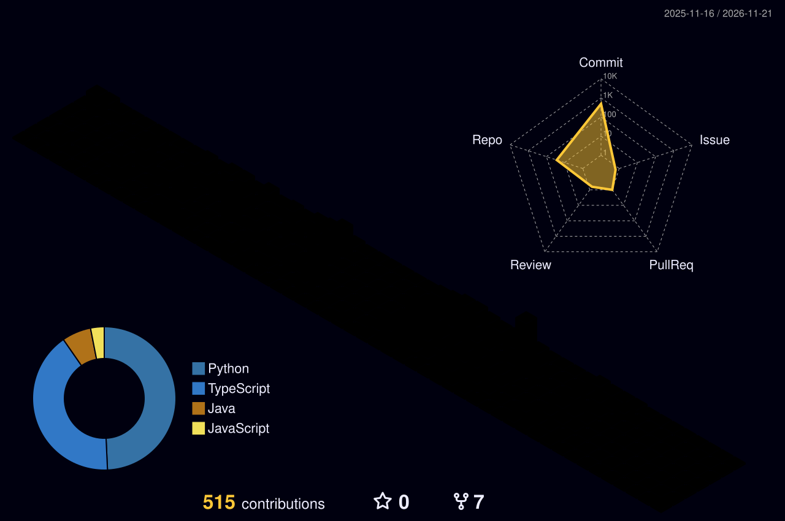

<h1 align="center">Hi 👋, I'm Ketan Gaikwad</h1>
<h3 align="center">AI engineer from Mumbai, India — I like to build things</h3>

  

- 🤖 I'm interested in **AI**

- 🔨 I like to **build things** — and I build a lot of them

- 🏆 **6× Hackathon Winner**

- 🌱 Always learning something new

- 👨‍💻 All of my projects are available at [gaikwadketan.vercel.app](https://gaikwadketan.vercel.app/)

- 📫 How to reach me **ketangaikwad2905@gmail.com**

  
  
  

 

---

## Tools I build with

  
   
  
   
  

---

## GitHub stats

  
  

  

---

## Watch the snake eat my contributions

  <picture>
    <source media="(prefers-color-scheme: dark)" srcset="https://raw.githubusercontent.com/ketan-2905/ketan-2905/output/snake-neon.svg"/>
    <source media="(prefers-color-scheme: light)" srcset="https://raw.githubusercontent.com/ketan-2905/ketan-2905/output/github-snake.svg"/>
    
  </picture>

---

## My year in 3D

  

