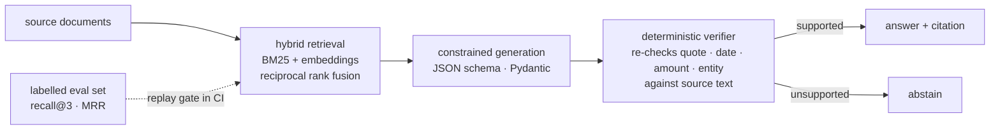

<div align="center">

<a href="https://gaikwadketan.vercel.app/"></a>

<br/>

<a href="https://gaikwadketan.vercel.app/"></a>
<a href="https://www.linkedin.com/in/ketan-gaikwad-073171320"></a>
<a href="mailto:ketangaikwad2905@gmail.com"></a>


</div>

<!--EVAL:START-->
```console
$ eval-run --subject "Ketan Gaikwad" --live --explain

  sampling evidence ...... 42 public repos · 5 languages · 6 hackathon wins
  language mix ........... TypeScript 19, Python 10, JavaScript 10, Java 2
  last push .............. 0h ago
  judging ................ ████████████████████████████ 100%

  VERDICT   builds LLM systems that can prove they were right
  CONF      0.94
  ABSTAIN   when the sources don't support an answer

  evaluated at 2026-11-21 19:30 UTC · this block is regenerated daily by CI
```
<!--EVAL:END-->

> I work on the unglamorous half of AI: the part that checks whether the model was actually
> right. Retrieval evals, guardrails, structured outputs, traces. If an answer can't be traced
> back to the exact text that produced it, I don't ship it.

---

## check_01 · how I build

Every system below follows the same shape — retrieve, constrain, verify, and refuse to answer when the evidence isn't there.



The part people skip is the verifier. A model that is confidently wrong and a model that is right look identical until something independent re-checks the claim against the source.

---

## check_02 · the eval scorecard

Projects, scored the way I'd score anything else — on the number, not the adjective.

| build | the hard part | measured |
|---|---|:--|
| **RegWatch India**<br/>`self-hosted · guardrails · quantization` | A quantized Qwen2.5 Q4_K_M on llama.cpp emits obligations, deadlines and entities as schema-constrained JSON, behind a deterministic verifier that re-checks every quote, date, amount and entity against source text | **100%** hallucinated dates/amounts/quotes caught<br/>**0 of 30** prompt injections obeyed<br/>**recall@3 1.00 · MRR 0.94** (vs 0.83 keyword)<br/>**8.8s → 17.5ms** p50 with semantic cache |
| **[ContextLens](https://github.com/ketan-2905/contextlens)**<br/>`observability · root-cause` | Reconstructs the model-visible context, retrieval, prompt assembly and tool calls behind **one** failed turn — every context item flagged available / selected / included, so a failure localises to retrieval, ranking or assembly instead of one undifferentiated miss | **11** deterministic rules run before any model call<br/>**16** instrumented failure scenarios with ground truth<br/>single-variable counterfactual replay |
| **[LitAgent](https://litagent.vercel.app/)**<br/>`agentic · tool calling · graph RAG` | An agent decomposes a question, calls arXiv and Semantic Scholar, parses PDFs and walks citation trails; a role-specialised reviewer council does supervisor consensus and cross-source contradiction detection | Pydantic-validated structured output at **every** hop<br/>Neo4j knowledge graph retrieval<br/>abstains when sources don't support it · [code](https://github.com/ketan-2905/litagent) |
| **VoiceHire AI**<br/>`realtime · streaming STT/TTS` | 16 kHz PCM from an AudioWorklet → streaming transcription → a 70B turn policy → bidirectional TTS, over a **single** FastAPI WebSocket | barge-in cancels in-flight speech on first partial<br/>turn-taking from silence + end-of-turn signals, not timers<br/>transcripts flush on disconnect, sessions resume |
| **[Nutrigenomics GraphRAG](https://github.com/ketan-2905/Nutrigenomics-GraphRAG)**<br/>`graph retrieval` | SNPs → genes → traits → biomarkers → nutrients → foods, as one queryable graph | Neo4j + ChromaDB, Redis cache, Prometheus + Grafana |
| **[SIEMAssist](https://siemassist.vercel.app/)**<br/>`security · conversational` | A natural-language question about security telemetry, turned into an actual investigation | tool-calling over SIEM data |

<details>
<summary><b>the rest of the shelf</b></summary>

<br/>

| | |
|---|---|
| [**LendSite**](https://github.com/ketan-2905/lendsite) | Audited ETL from 4 source formats into a reconciled PostgreSQL star schema; SQL marts for DPD, PAR, vintage, roll-rate and ECL; explainable early-warning model |
| [**Customer Retention**](https://github.com/ketan-2905/customer-retention) | Six sources into a dimensional warehouse, churn + propensity models, ranked retention and cross-sell queues |
| [**Banking Risk Intelligence**](https://github.com/ketan-2905/banking-risk-intelligence) | Ledger-safe risk scoring, escrow-based review, AI-assisted analyst triage — Spring Boot, PostgreSQL, Redis, JWT |
| [**QuickCart**](https://github.com/ketan-2905/quickcart) | Local-first quick-commerce platform, written as a production-grade backend exercise in Java |
| [**Equilibrium**](https://equilibrium-mu.vercel.app) | Systemic-risk simulation for financial networks — *Winner, DATATHON 2026* |
| [**Eco-Sort**](https://github.com/ketan-2905/Eco-sort) · [**FederShield**](https://federshield.vercel.app) · [**Redact CyberSecure**](https://redact-cybersecure-tau.vercel.app) · [**NexusEvent**](https://nexusevent-drab.vercel.app) | Hackathon builds: waste identification, federated defence, security ML, QR-based event validation |

</details>

---

## check_03 · the toolbox

```yaml
llm_systems:   RAG · hybrid search · reranking · retrieval eval · tool calling
               structured outputs · MCP · LLM-as-a-judge · guardrails
models:        llama.cpp · quantization (Q4_K_M) · sentence-transformers
               OpenAI API · Groq · streaming STT/TTS
languages:     Python · TypeScript · Go · SQL · JavaScript
backend:       FastAPI · Django REST · WebSockets · Celery · REST
data:          PostgreSQL · pgvector · Neo4j · Redis · DuckDB · SQLite FTS5
infra:         Docker · Nginx · CI/CD · GCP
observability: Prometheus · OpenTelemetry · pytest
```

<div align="center">

</div>

---

## check_04 · wins on the board

<div align="center">

🥈 **Codex Community Hackathon**, Infosys Pune — 2nd Place · **$2K** &nbsp;·&nbsp; 🥇 **Hawkathon 2026**, AI Skill Tech University — 1st Place

🥇 **DATATHON 2026 (Core ML)** — Winner at KJSCE &nbsp;·&nbsp; 🏅 **Hackxios 2026** &nbsp;·&nbsp; **Hackniche 2026** &nbsp;·&nbsp; **HACKANOVA 5.0**

**6× hackathon winner** &nbsp;·&nbsp; B.Tech CSE (Data Science), Honours in Computational Finance, DJ Sanghvi &nbsp;·&nbsp; CGPA **8.92** &nbsp;·&nbsp; Web Dev Head, DJS NOVA

</div>

---

## check_05 · the trace

<div align="center">


<br/><br/>

<picture>
  <source media="(prefers-color-scheme: dark)" srcset="https://raw.githubusercontent.com/ketan-2905/ketan-2905/output/snake-neon.svg"/>
  <source media="(prefers-color-scheme: light)" srcset="https://raw.githubusercontent.com/ketan-2905/ketan-2905/output/github-snake.svg"/>
  
</picture>

### the arcade

Same contribution grid, three more ways to destroy it.

<b>PAC-MAN</b><br/>
<sub>ghosts included</sub>

<picture>
  <source media="(prefers-color-scheme: dark)" srcset="https://raw.githubusercontent.com/ketan-2905/ketan-2905/arcade/pacman-contribution-graph-dark.svg"/>
  <source media="(prefers-color-scheme: light)" srcset="https://raw.githubusercontent.com/ketan-2905/ketan-2905/arcade/pacman-contribution-graph.svg"/>
  
</picture>

<b>BREAKOUT</b><br/>
<sub>one commit, one brick</sub>

<picture>
  <source media="(prefers-color-scheme: dark)" srcset="https://raw.githubusercontent.com/ketan-2905/ketan-2905/arcade/breakout-contribution-graph-dark.svg"/>
  <source media="(prefers-color-scheme: light)" srcset="https://raw.githubusercontent.com/ketan-2905/ketan-2905/arcade/breakout-contribution-graph.svg"/>
  
</picture>

<b>TETRIS</b><br/>
<sub>the grid, stacked</sub>

<picture>
  <source media="(prefers-color-scheme: dark)" srcset="https://raw.githubusercontent.com/ketan-2905/ketan-2905/arcade/tetris-contribution-graph-dark.svg"/>
  <source media="(prefers-color-scheme: light)" srcset="https://raw.githubusercontent.com/ketan-2905/ketan-2905/arcade/tetris-contribution-graph.svg"/>
  
</picture>


### the year, in three dimensions


</div>

---

<div align="center">

```console
$ eval-run --explain --why

  ✔ grounded      every claim above maps to a public repo
  ✔ reproducible  numbers come from a labelled eval set
  ✔ abstains      says "I don't know" instead of guessing

  → ketangaikwad2905@gmail.com
```

</div>

