---

<h2 align="center">Projects</h2>

<table align="center">
<tr>
<td width="50%" align="center" valign="top">

</td>
<td width="50%" align="center" valign="top">

</td>
</tr>
<tr>
<td width="50%" align="center" valign="top">

</td>
<td width="50%" align="center" valign="top">

</td>
</tr>
</table>

---

<h2 align="center">Stats</h2>

---

<picture>
  <source media="(prefers-color-scheme: dark)" srcset="https://raw.githubusercontent.com/ketan-2905/ketan-2905/arcade/tetris-contribution-graph-dark.svg"/>
  <source media="(prefers-color-scheme: light)" srcset="https://raw.githubusercontent.com/ketan-2905/ketan-2905/arcade/tetris-contribution-graph.svg"/>
  
</picture>

