<h1 align="center">Hi 👋, I'm Ketan Gaikwad</h1>
<h3 align="center">I'm interested in AI and I like to build things</h3>

 

  

  

<picture>
  <source media="(prefers-color-scheme: dark)" srcset="https://raw.githubusercontent.com/ketan-2905/ketan-2905/arcade/pacman-contribution-graph-dark.svg"/>
  <source media="(prefers-color-scheme: light)" srcset="https://raw.githubusercontent.com/ketan-2905/ketan-2905/arcade/pacman-contribution-graph.svg"/>
  
</picture>

## Projects

<table align="center">
<tr>
<td width="50%" align="center" valign="top">

</td>
<td width="50%" align="center" valign="top">

 

</td>
</tr>
<tr>
<td width="50%" align="center" valign="top">

</td>
<td width="50%" align="center" valign="top">

 

</td>
</tr>
</table>

## Stats

 

